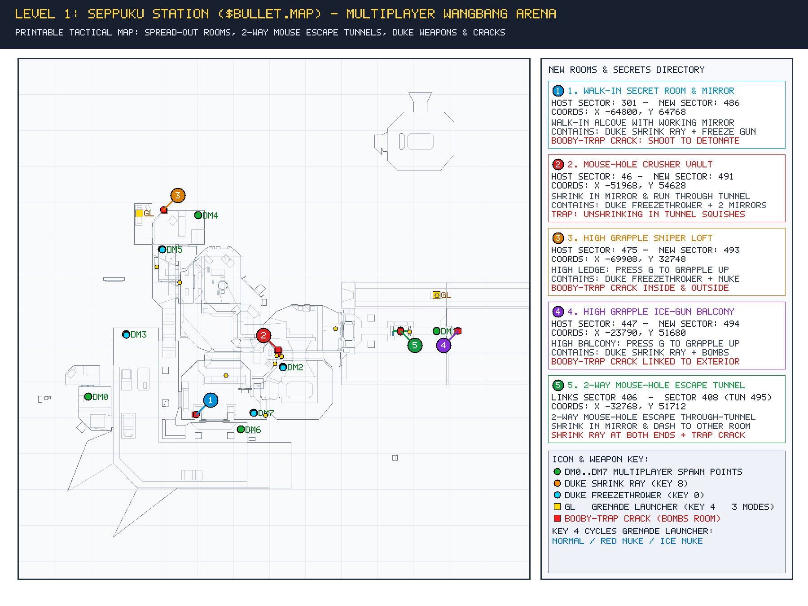
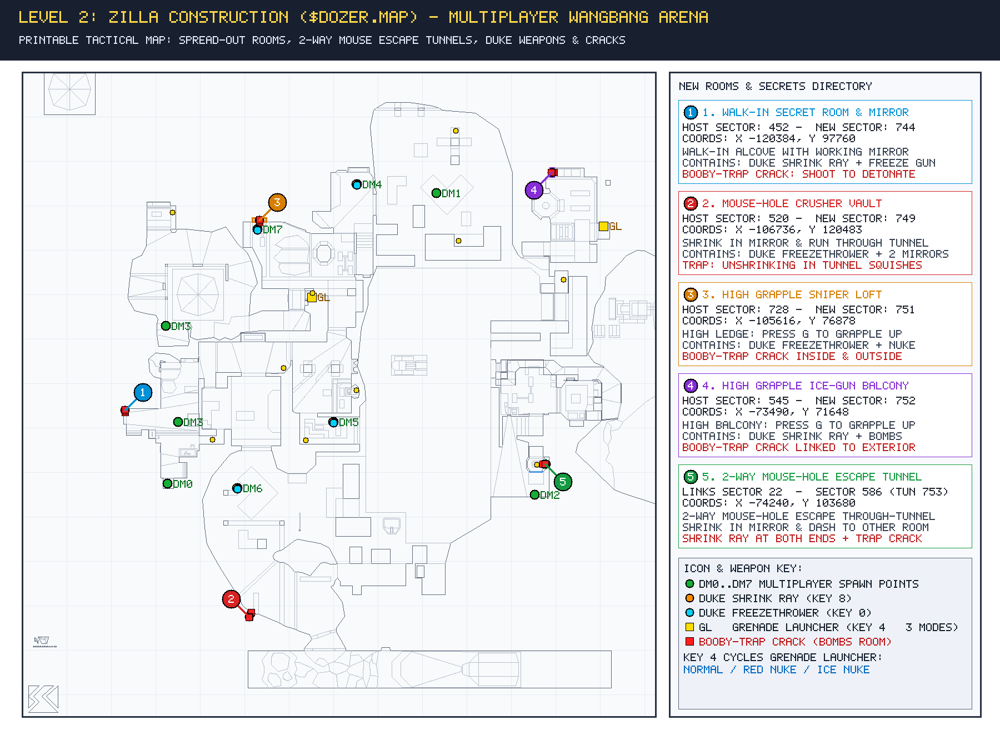
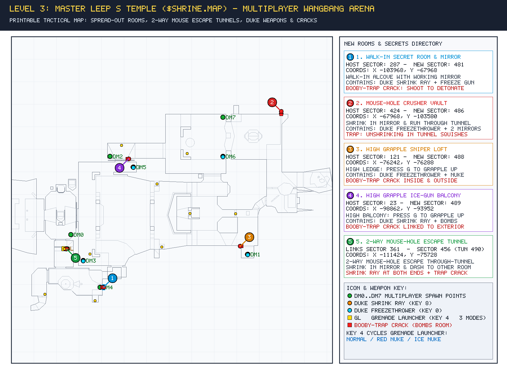
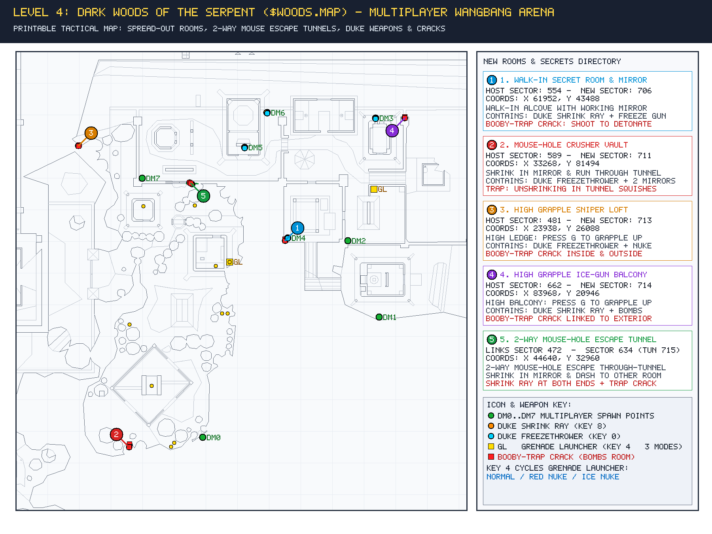

# Shadow Warrior — Brett Edition (V8 & V7 Complete Package)

## ⬇️ One-Click Standalone Windows Installer

For players who want a ready-to-play setup with **all game data (`sw.grp`, `wt.grp`), ported Duke 3D art (`TILES022.ART`), modded Multiplayer maps, printable tactical map guide, C++ runtime, and both playable editions** pre-configured:

### 👉 [**Download `ShadowWarrior_Setup.exe` (44.9 MB — Standalone Installer)**](https://github.com/bm069au/shadow-warrior-edits/releases/latest/download/ShadowWarrior_Setup.exe)
*(Or browse the [**Releases Page**](https://github.com/bm069au/shadow-warrior-edits/releases) / download [`ShadowWarrior_Setup.exe`](./ShadowWarrior_Setup.exe) directly from the repository.)*

- **Default Install Path:** `C:\Program Files\Shadow Warrior` (with a **Browse...** button if you prefer another folder).
- **100% Self-Contained (`user_profiles_disabled`):** Everything (`sw.grp`, `wt.grp`, `TILES022.ART`, `sw.cfg`, modded maps, and savegames) stays inside the install folder without scattering files into `AppData`.
- **Includes Printable Tactical Map Guide:** Open [`PRINTABLE_MAP_GUIDE.html`](./PRINTABLE_MAP_GUIDE.html) in any browser and press `Ctrl + P` to print 1 Multiplayer arena map per page.
- **Creates Desktop & Start Menu Shortcuts for Both Included Editions:**
  1. **Shadow Warrior (V8 Grapple, Shrink & Freeze Edition)** — `sw.exe` / `sw_grapple_shrink_freeze_V8.exe`
  2. **Shadow Warrior (V7 Boss Bunnies & Stalker Mines Edition)** — `sw_boss_bunnies_stalker mines V7.exe`

---

## 🎮 What's New in V8 (Authentic Duke 3D Shrinker/Freezer, 3-Mode Grenade Launcher & Tactical MP Maps)

### 1. Authentic Ported Duke Nukem 3D Weapons & 3-Mode Grenade Launcher
- **3-Mode Grenade Launcher Toggle (`Key 4`):**
  - Press **`4`** repeatedly while holding the Grenade Launcher to cycle between **3 tactical modes** (displayed on the top-center HUD banner):
    - **Mode 0 — Normal Grenades:** Standard bouncing fragmentation shells.
    - **Mode 1 — Red Nuclear Grenades (`Pal 23`):** Consumes **2** grenade shells + requires a Nuclear Warhead pickup (`Icon_Nuke`) in inventory; triggers full nuclear flash, shockwave, and radiation fallout.
    - **Mode 2 — Ice Nuke Grenades (`Pal 20`):** Consumes **1** grenade shell; explodes in an icy shockwave that **freezes every player/enemy in radius for 10 seconds**, strips **Armor to `0`**, drops **HP to `20`**, and bursts **40 flying Duke 3D ice shards (`GLASSPIECES`)**!
  - **Roof-Hole & Sky-Arc Bypass:** Grenades drop cleanly through Room-Over-Room (ROR) roof openings (`FAF_MIRROR_PIC`) and arc over outdoor parallax-sky walls.
- **Authentic Duke 3D Shrink Ray (`Key 8` — `TILES022.ART`):**
  - Ported directly from Duke Nukem 3D (`tiles 5632..5638`, `SHRINKSPARK` velocity `768`).
  - Shrinks enemy players (`xrepeat=11, yrepeat=11`) or enemies (`16, 16`) for **10 seconds**, or shoot any **Mirror Wall** to bounce the beam back and shrink yourself!
  - **Shrunken Combat:** Shrunken players pump tiny **Duke 3D Fists (`5675..5677`)** and can be **Foot-Stomped (`5685..5686`)** on contact by full-size players.
- **Authentic Duke 3D Freezethrower (`Key 0` — `TILES022.ART`):**
  - Ported directly from Duke Nukem 3D (`tiles 5640..5654`, `FREEZEBLAST` velocity `644`).
  - **3x Wall-Bounce Trick Shots:** Ice bolts bounce off walls and mirrors up to **3 times** (`BounceSprite()`).
  - Frozen targets turn ice-blue (`Pal 20`) and shatter into **40 flying `GLASSPIECES` (`5652..5654`)** when kicked or shot.
- **Grappling Hook (`G` Key Toggle):**
  - Fires a rooftop/ceiling grapple line to pull you into the high **Grapple Sniper Lofts (`③`)** and **High Grapple Ice-Gun Balconies (`④`)**. Press **`G`** again to release.

### 2. Tactical Multiplayer (WangBang) Map Expansions & Linked Booby-Trap Cracks
Each of the 4 Shareware levels (`$bullet.map`, `$dozer.map`, `$shrine.map`, `$woods.map`) has **5 spread-out tactical rooms/tunnels (`①`–`⑤`)** placed **100% inside the Multiplayer (WangBang) Deathmatch Arena (`hitag == 42`)**, spaced `16,000`–`37,000` Build units apart across all quadrants:
1. **`①` Walk-In Secret Room & Mirror:** Hidden behind a fake window (`picnum = 3`) or walk-through wall (`cstat = 0`) with a working back-wall mirror, Duke Shrink Ray + Freezethrower, and a **linked Booby-Trap Crack (`picnum = 80, lotag = 257`)**—shooting or bombing the crack from outside detonates the entire room inside!
2. **`②` Mouse-Hole Crusher Vault:** Exterior working mirror to self-shrink and dash through a low **`22`-Z-unit mouse-hole tunnel** into the inner vault (Freezethrower + 2 interior mirrors). Unshrinking inside the tunnel squishes the player!
3. **`③` High Grapple Sniper Loft:** Elevated `18` Z-units above the floor (press **`G`** to grapple up); contains Duke Freezethrower + Nuke Warhead + linked Booby-Trap Crack.
4. **`④` High Grapple Ice-Gun Balcony:** Opposite-quadrant elevated sniper balcony (press **`G`** to grapple up); contains Duke Shrink Ray + Grenade Shells + linked Booby-Trap Crack.
5. **`⑤` 2-Way Mouse-Hole Escape Through-Tunnel:** A low-ceiling (`Z(22)`) **two-way mouse-hole escape tunnel cut directly through a wall between two separate rooms/corridors** (including inside the **Grenade Launcher & Health Room (`Sector 361` <-> `Sector 456`)** in *Master Leep's Temple*), with working mirrors and Shrink Rays at both ends!

---

## 🗺️ Printable Tactical Multiplayer (WangBang) Maps

Open [**`PRINTABLE_MAP_GUIDE.html`**](./PRINTABLE_MAP_GUIDE.html) and press **`Ctrl + P`** for clean single-page printouts, or view the 4 Multiplayer arena diagrams below:

### Level 1: Seppuku Station (`$bullet.map` — Multiplayer WangBang Arena)

### Level 2: Zilla Construction (`$dozer.map` — Multiplayer WangBang Arena)

### Level 3: Master Leep's Temple (`$shrine.map` — Multiplayer WangBang Arena)

### Level 4: Dark Woods of the Serpent (`$woods.map` — Multiplayer WangBang Arena)

